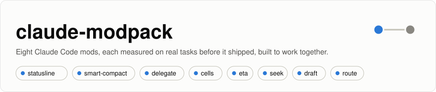
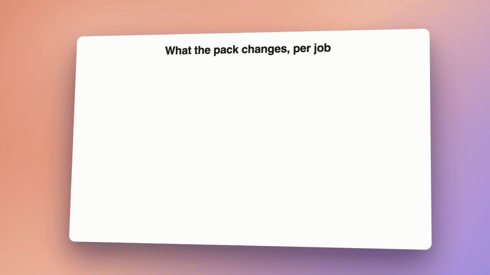
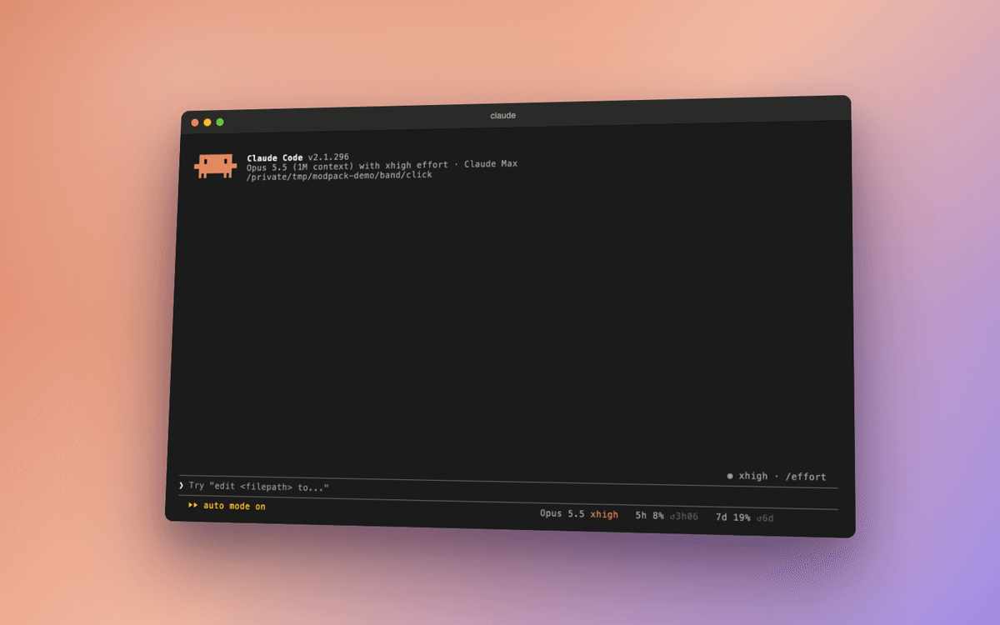
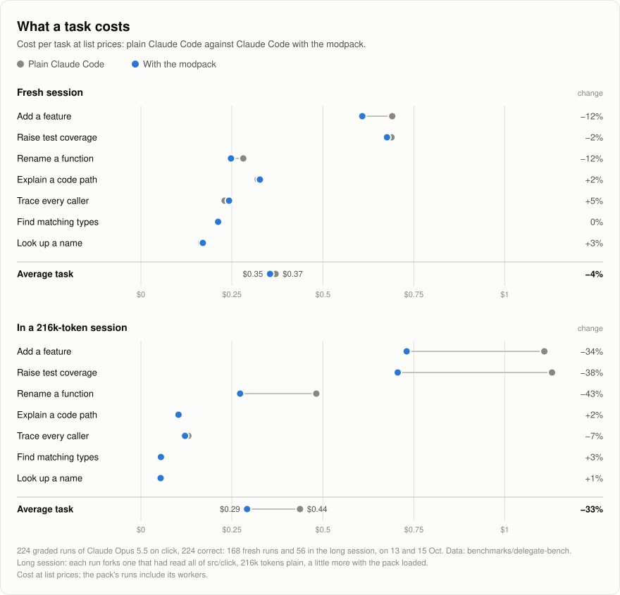
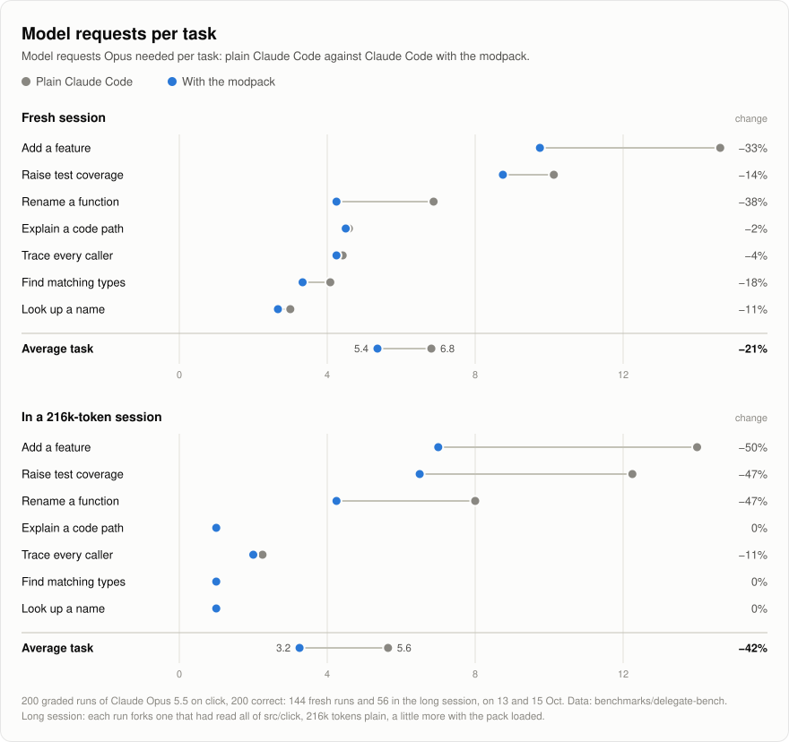
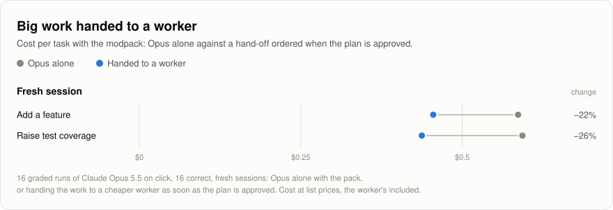

<div align="center">

<picture>
  <source media="(prefers-color-scheme: dark)" srcset="assets/banner-dark.svg">
  
</picture>

<h3>Install in Claude Code</h3>

```
/plugin install modpack --marketplace HarzerHeribert/claude-modpack
```

Answer `y`, then run `/modpack:setup` to set everything up step by step.<br>
Prefer doing it by hand? [SETUP.md](SETUP.md) has every step.

<br>

[](https://github.com/HarzerHeribert/claude-modpack/releases) [](LICENSE)  [](benchmarks/delegate-bench/SUITE.md) [](#the-mods-in-depth) [](https://harzerheribert.github.io/claude-modpack/notes.html)

### Claude Code with fewer wasted steps, and a clear view of what it's doing.

Eight free add-ons that work on their own. One command installs them, and there is nothing new to learn.<br>
Every number on this page was measured, including where it doesn't help.

[Install](#install) · [What you get](#what-you-get) · [Honest numbers](#honest-numbers) · [The site: ideas and evidence](https://harzerheribert.github.io/claude-modpack/) · [Lab notes](https://harzerheribert.github.io/claude-modpack/notes.html) · [Questions](#questions)

</div>

<br>



## Why it saves

Every time Claude takes a step (reads a file, makes an edit, runs the tests), it reads your whole conversation again. That re-reading is most of what a session costs, and it grows the longer you work. So the cheapest step is the one Claude never has to take.

The pack takes out steps that need no thinking. Several edits and their test run as one step. A search for a name in your code comes back with the exact answer. And when you approve a plan, a cheaper model does the building while Claude checks the result. The work comes out the same; Claude just gets there in fewer round trips.

## What you get

### Always know where your plan stands



One line under the prompt: the model, how full the conversation is, and how much of your plan's 5-hour and weekly limits you have used, with when each one resets. Long jobs get a progress bar and a finish time above the prompt. And when you step away, your session is kept ready, or tidied up before it goes cold, whichever costs less; the line tells you which.

These are the **statusline**, **eta** and **smart-compact** mods.

### Several changes in one step, and you can still undo them


Claude makes several edits and runs the tests as one step, and you watch each part happen in a live card. Every edit still goes through Claude Code's own edit tool: you see each change, and `/rewind` undoes it.

That's the **cells** mod.

### A cheaper model builds what you approved


When you approve a plan, Claude hands the building to Sonnet, a cheaper model, and checks its work before reporting back. In our tests that made a feature 22% cheaper and new tests 26% cheaper, with every result correct (corrected 16 Oct: worker costs were undercounted; it was 27% and 33%). You can watch the helper work in its card, and `/delegate` shows every step it took.

That's the **delegate** mod.

### Feature work goes to the cheaper model by itself (opt-in)

A small, fast classifier reads each prompt you send. Only when it is feature or test work is Claude told to hand it straight to delegate's worker: the worker reads the code and builds, delegate checks the result itself, and Claude reports after two steps of its own. On a TypeScript feature that made the job 51% cheaper and 42% faster than the pack alone, with every result correct (corrected 16 Oct: worker costs were undercounted; it was 57%); everything else stays with Claude. The classifier is an outside service (TypeSafe's Jev or ScaleDown), so this is off until you turn it on and give it a key: from then on, the start of each prompt goes to it, in the US, to be classified.

That's the **route** mod.

### Straight answers about your code

When Claude searches your code for a name, it gets the exact list of places that use it, from the same engine your editor uses, instead of reading through search results. Renames and "who calls this?" questions take fewer steps. New in 0.5.0: Go, Kotlin and Ruby code, shell scripts and Terraform. Run `/lsp-plus:setup` once in your project to turn it on.

That's the **lsp-plus** mod.

### Fewer, leaner steps when Claude looks around

Before Claude changes anything, it looks around your code, and everything it reads stays in the conversation, read again with every later step. Beside the first prompt you send in a session, and again as the session grows, the pack passes on your preference to look around in few, lean steps: the searches it can already name in one go, the lines that matter rather than whole files, nothing read twice. Against the pack without it, that made jobs 12% cheaper in a fresh session, 16% on a TypeScript library and 10 to 16% in long sessions, at the same quality. It runs on your machine and sends nothing anywhere.

That's the **seek** mod.

### You stay in control


`/mods` lists the eight and turns any of them on or off, right away, with a click or by typing, such as `/mods statusline off`. When something can't fully work on your computer, the pack tells you once, with the command that fixes it. When another plugin's permission or notification hook hangs (Warp's does outside the Warp terminal), the pack stops waiting for it after 10 seconds, so Claude Code can't freeze, and tells you which one it was. It keeps itself up to date (or only lets you know, if you prefer).

That's the **modpack** plugin, which installs the other eight.

## Install

In Claude Code, type:

```
/plugin install modpack --marketplace HarzerHeribert/claude-modpack
```

Answer `y` to add the marketplace, then pick where to install it. That installs all eight. Then, in the project you work in:

```
/modpack:setup
```

It checks your machine, asks once what you want on (route stays off unless you say yes), sets each mod up in order, including the language servers for the languages your project uses, and checks that each one works. Done. `/mods` shows what's on.

By hand instead: [SETUP.md](SETUP.md) has every step.

<details>
<summary>One mod alone, or setting the language servers up by hand</summary>
<br>

Each mod installs on its own the same way, for example `/plugin install smart-compact --marketplace HarzerHeribert/claude-modpack`. lsp-plus, delegate and cells build on Claude Code's LSP tool, which needs a language server for each language: [Language servers](#language-servers) lists them.
</details>

## Honest numbers

We measured the pack on Claude Opus 5.5 doing seven real jobs in an open-source project ([click](https://github.com/pallets/click)), from a one-line lookup to building a feature, on two days, 13 and 15 October. Every result was checked by hidden tests. The same jobs ran with the pack and without it, and we compared what they cost at API prices.

| Cost per job | Without | With the pack | |
| --- | --- | --- | --- |
| In a long session (Claude has already read the whole project) | $0.44 | $0.29 | **−33%** |
| Bigger jobs in a long session (a feature, tests, a rename) | $0.91 | $0.57 | **−37%** |
| In a fresh session | $0.37 | $0.35 | −4% |
| Bigger jobs in a fresh session | $0.55 | $0.51 | −8%, and 15% faster |
| Quick questions in a fresh session | $0.23 | $0.24 | +2%, about even |

- **Where it doesn't help:** quick questions in a brand-new session. The pack's tools come along with every step, and a three-step lookup has little to save: 5% more one day, 4% less the next, about even.
- **Writing tests:** the pack alone saves nothing there (−2%, 12 runs each way): every step waits on the last test run. route hands it to the worker instead (−36% to −46%, below).
- **Nothing got worse:** all 224 runs behind this table produced a correct result, with the pack and without.
- **The 95% ranges:** long session −39% to −27%; fresh −7% to −1%; bigger jobs fresh −12% to −3%; quick questions −1% to +6%. The long session is two runs per job each day, and the days differ: −26% on one, −40% on the other, mostly from the feature (plain needed 12 requests one day, 16 the next).
- **The same on other code:** on a TypeScript library ([chrono](https://github.com/wanasit/chrono)) the pack cost 7.6% less (−12% to −3%) and took fewer steps on all eight jobs. On 30 real bug reports from SWE-bench Verified it fixed 30 against 29, with 23% fewer steps; the cost, −12%, is not certain at one attempt per bug (−33% to +12%).
- **A plan handed to a cheaper model:** −22% on a feature, −26% on tests, against Opus doing it alone with the pack (16 runs, all correct).
- **With route turned on:** a further −14% on click's eight jobs (route 0.1). With 0.6.0's verified hand-offs, against the pack in the same batch on TypeScript: a feature −51% and 42% faster, writing tests −36%; Claude itself takes 2 steps instead of 6 to 11 (24 runs, all correct).
- **Corrected 16 Oct: worker costs were undercounted.** A worker's transcript records its output as each response began, and our bench counted it from there, so every number with a hand-off in it came out too good. Corrected from Claude Code's own totals: a planned feature −22% (was −27%), tests −26% (was −33%), route on click −14% (was −17%), the TypeScript feature −51% (was −57%). Every saving is still a saving, a smaller one. The table above has no hand-offs and did not change. Each claim, old and new: [CORRECTION-1016.md](benchmarks/delegate-bench/CORRECTION-1016.md).
- **With seek** (new in 0.6.0, measured against the pack rather than plain Claude Code, so not in the table above): −12% fresh on click, −16% on TypeScript, −10% to −16% in long sessions ([seek](#the-mods-in-depth), below).
- **Two days, two versions:** the 13 October runs used the pack as of 0.3.0 and Claude Code 2.1.296, the 15 October runs 0.4.0 and 2.1.299. What changed in the pack between them (on/off switches, setup, messages shown when a worker is refused) never reached the model in these runs: its first request was 26.7k tokens plain and 30.6k with the pack on both days. The second day's plain runs were done twice, because the first try had the pack installed by mistake: [lab notes 8](lab-notes/08-our-plain-runs-were-not-plain.md) tells how we caught it.

<picture>
  <source media="(prefers-color-scheme: dark)" srcset="assets/cost-dark.svg">
  
</picture>

<details>
<summary>Steps per job, and the hand-off chart</summary>
<br>

<picture>
  <source media="(prefers-color-scheme: dark)" srcset="assets/requests-dark.svg">
  
</picture>

<picture>
  <source media="(prefers-color-scheme: dark)" srcset="assets/delegate-dark.svg">
  
</picture>
</details>

How we measured, every run's record, and the scripts to run it all again are in [`benchmarks/`](benchmarks/), starting with [SUITE.md](benchmarks/delegate-bench/SUITE.md). What we tried that did not make it, a 10,000-star code graph among it, is in the [lab notes](https://harzerheribert.github.io/claude-modpack/notes.html) ([as Markdown](lab-notes/)). Not measured: what smart-compact saves you while you're away (worked out from prices, not tested) and Windows.

## Questions

**Will Claude's work get worse?**
No. In every run we graded, 730 in all, the result was correct with the pack and without, and every one was graded again for this release. The pack changes how many steps Claude takes to get there, and in our tests the results came out the same.

**Is it safe?**
It's open source (MIT), so every line is here to read. Code that Claude runs inside a cell runs in a sandbox with no network access. Edits go through Claude Code's own edit tool, so your usual permission prompts and `/rewind` still apply. The pack sends nothing anywhere except a once-a-day check on GitHub for a new release, which you can turn off, and, only if you turn route on, the start of each prompt to the classifier you chose (TypeSafe or ScaleDown).

**Does the pack add anything to my prompts?**
Your prompt itself is never changed. Beside it, Claude can get a short note in your name: seek's setting to look around in few, lean steps (with the first prompt of a session, and again after a compaction), and, only if you turn route on, the order to hand feature or test work to the worker; delegate gives the same order when you approve a plan of 20 lines or more. A subagent Claude starts gets cells' and seek's settings at the end of its task, since your prompts never reach it. `/mods seek off` and `/mods route off` stop theirs; `subagents: false` in cells or seek stops theirs for subagents.

**I'm on a Pro or Max plan. Does this help me?**
You don't pay per job, but every step counts against your 5-hour and weekly limits. We measured cost at API prices, not plan usage, so we can't promise a number. Fewer, lighter steps should leave more of your limits, and the status line shows exactly where you stand.

**Does it work in the desktop app?**
Yes, cards, progress and the status line included. One limit: in auto mode the desktop app doesn't let an add-on start a helper model, so plans aren't handed off there (turn route off there too); in manual mode, or in the terminal, they are. Windows hasn't been tested yet.

**How do I turn it off?**
`/mods` switches each part off or on, right away. `/plugin` removes them.

**Were any of these numbers wrong?**
Yes, the hand-off ones. On 16 October we found that our bench had counted a worker's output only as each of its responses began, so every saving that involved a worker came out too large: a planned feature was −27% and is −22%. They are corrected here, the old and new number side by side in [CORRECTION-1016.md](benchmarks/delegate-bench/CORRECTION-1016.md). The pack-against-plain numbers had no workers and stand.

**What does it cost?**
Nothing. It's free and open source.

## The mods in depth

<details>
<summary><b>statusline</b>: interface: one line under the prompt with what matters</summary>
<br>

One line under the prompt, drawn in Claude Code's own hint row so the mode indicator and the status share it:

```
⏵⏵ auto mode on       Opus 5.5 xhigh   412k ━━━━━━──────   5h 34% ↺2h14   7d 12% ↺3d   ● ready · cold in 44m
```

- **Its own segments:** the model and its effort, the context against the auto-compact point (a highlight sweeps along it while Claude works), and how much of the plan's 5-hour and 7-day windows is used, with when each resets: quiet under half, plain past it, amber from 80%.
- **Other mods' segments:** a mod calls `$.statusline.set({ id, priority, parts, short?, side? })` and lists `statusline` among its dependencies. A part is text, a countdown (`{ until, prefix?, warnMs? }`, counted by the line) or a spinner (`{ spin: true }`), so a mod sends a segment when it changes, not every second. `$.statusline.remove({ id })` takes it off.
- **Narrow terminals** drop the least important first: the model, then the windows' resets, the windows, the gauge, and another mod's countdown before its own words.
- **Published pages:** a pill on the left lists the pages this session published with the Artifact tool.
- **Phone and IDE:** where no line is drawn, the same line is the session's status text, in a session the phone or IDE hosts. A terminal session watched over Remote Control (`/rc`) from the desktop app, the web or the phone gets no mod drawing and no status text as of Claude Code 2.1.296.

| Option | Default | |
| --- | --- | --- |
| `enabled` | `true` | `false` turns the mod off; `/mods` does it for all of the pack. |
| `placement` | `line` | `tail`: appended dim to Claude Code's hint. `band`: above the prompt. `off`. |
| `limits` | `always` | `half`: a plan window only once it is half used. `off`: never. |
| `animate` | `true` | The highlight along the gauge. |

</details>

<details>
<summary><b>smart-compact</b>: cost: keeps the prompt cache warm, or compacts before it expires</summary>
<br>

An idle session's prompt cache expires after its TTL: 1 hour on a subscription, 5 minutes in overage or on an API key. The next prompt then writes the whole context to the cache again, at 1.25x (5 min) or 2x (1 h) the input price. For a 400k-token Opus 5.5 session on the 1-hour cache:

| Option | Cost |
| --- | --- |
| Let it expire, re-cache on return | $3.20 |
| One keep-alive (re-read the cached prefix; a read resets the TTL) | $0.09 |
| Compact before it expires | ~$0.87, plus detail lost to the summary |

A few minutes before the cache expires (2.5 min on the 1-hour TTL, 45 s on the 5-minute one), the `smart` strategy:

1. Sends keep-alives while they cost less than compacting would, counting lost detail as `compactPenaltyUsd`. It stops after `maxIdleHours`.
2. Then compacts while the cache is still warm.
3. Leaves small sessions alone: below `minSavingsUsd` of re-cache cost, or below `minCompactTokens` of context, it never compacts.

It never compacts while the prompt holds a draft or agents are running; it sends a keep-alive to hold the cache instead. If the machine sleeps past the deadline, it marks the cache expired and does nothing. A failed action is retried twice, 20 s apart. The TTL is detected from the plan and corrected from the cache hits and misses it observes.

On statusline's line it says whether the session is ready to prompt or has gone cold: `● ready`, `· cold in m:ss` (amber in the last five minutes), `· compacts in …` when an idle compaction is near, `○ cold`, or what it is doing (`compacting`, `keeping warm`, `paused`). `/cache` shows the live figures and plan; `/cache pause`, `/cache resume` and `/cache keepalive` control it.

| Option | Default | |
| --- | --- | --- |
| `enabled` | `true` | `false` turns the mod off; `/mods` does it for all of the pack. |
| `strategy` | `smart` | `compact`: compact at the first expiry. `keepalive`: never compact. `off`: status line only. |
| `cacheTtl` | `auto` | `1h` or `5m` to override detection. |
| `minSavingsUsd` | `0.25` | Below this re-cache cost, the cache is left to expire. |
| `compactPenaltyUsd` | `0.5` | Higher keeps the cache warm longer before compacting. |
| `minCompactTokens` | `100000` | Never compacts a smaller context. |
| `maxIdleHours` | `6` | Stops keep-alives after this long idle. |
| `compactInstructions` | empty | Passed to idle compactions, like `/compact <text>`. |

Prices are list prices, so on a subscription they are API-equivalent estimates, not a bill.

</details>

<details>
<summary><b>delegate</b>: cost: hands big, specified work to a cheaper worker</summary>
<br>

Every request of the main model re-reads its whole context: at 600k tokens on Opus 5.5 that is about $0.12 a step before any work is done. A worker reads only its own small context. Claude calls `hand_off` with a task that stands alone, its kind (`read`: changes no file; `mechanical`: the task spells out every change; `build`: something is left to work out), the symbols or `file:line` places it touches (`focus`), and for edits a `check` command. The kind picks the worker, so Claude has no model to weigh: Haiku at low effort for read and mechanical work, Sonnet at medium for build work.

1. **Where it reaches.** For each focus entry the mod asks the language server for references and callers (with lsp-plus, the docs that mention it come along) and tells the worker.
2. **The worker.** A subagent, read-only for `read`, with Edit and Write for `mechanical` and `build`. The call waits for it inside the tool call (one request of the main model) and returns the report with the evidence; with `background` it returns at once and the report arrives as a message. A follow-up within 50 minutes goes to the same worker, its reading still in its context.
3. **The evidence.** The diff against a git snapshot taken at the start, however the worker edited; the check command, run by the mod itself; references outside the changed files; what the work cost against the same steps on the main model.
4. **The review.** The main model judges the diff and the check, not the report.
5. **The log.** Each hand-off goes to `~/.claude/mods/delegate/log.jsonl`; `/delegate` sums it up and opens a side pane. While a worker runs, its card is drawn like a cell (the task, a row per step, the state and cost), and with eta loaded it is a row above the prompt too.

Measured on 120 Opus runs, all correct: a feature or tests cost 23–35% less handed off; lookups, traces, explanations and small edits cost more. Opus does not hand off unless told to, so ask for it as an instruction: "hand the tests to a worker". An order the mod gives works as well as yours (8 of 8 runs, 22–26% less), so when you approve a plan of 20 lines or more, delegate gives that order: plan in plan mode, approve, and a Sonnet worker builds it. Corrected 16 Oct: worker costs were undercounted; these were 27–37% and 27–33%.

**A verified hand-off** (0.3.0). The worker ends its report with a VERIFY block: the command that runs only its new tests, and what it left open. delegate runs that command beside the check, counts both (no test selected is no pass), and its result starts with one line: Verified, with what passed, or Not verified, with each reason. On Verified, Claude reports without running anything again: after a hand-off it then needs one step, the answer, instead of two or three.

**A verified answer** (0.4). A `read` hand-off ends with a PLACES block, one `path:line symbol` per place it names; delegate checks each place in the code and puts Verified or Not verified first. Handed off with it, lookups cost about what they cost Claude alone (+5%, corrected from +4%), so it is a safety net for the answer, not a saving. The worker starts in your session's project directory and is told the project's root, so it cannot answer from another copy of the project on the disk, and the diff is taken from the repository's top.

| Option | Default | |
| --- | --- | --- |
| `enabled` | `true` | `false` turns the mod off; `/mods` does it for all of the pack. |
| `readWorker` | `haiku:low` | Model and effort for `read` hand-offs. |
| `mechanicalWorker` | `haiku:low` | For `mechanical` ones. |
| `buildWorker` | `sonnet:medium` | For `build` ones. |
| `afterPlan` | `hand_off` | When you approve a plan of 20 lines or more, Claude is told to implement it through a hand-off, the plan as the worker's spec; a smaller plan it does itself. `off`: never. |
| `framing` | `hand_off` | `capability`: the same tool offered as `implement_spec(spec, check)` (measured: never used unasked either). |
| `wait` | `tool` | `tool`: the call waits for the report. `message`: it returns at once. Claude can pick either per call with `background`. |
| `review` | `inline` | `fork`: a forked review returns a verdict only. `auto`: fork for large evidence. |
| `reuseMinutes` | `50` | How long a worker stays warm for follow-ups. |
| `workerContextCap` | `60000` | A worker grown past this is not continued. |

</details>

<details>
<summary><b>route</b>: cost: sends feature and test work to delegate's worker (off until you turn it on)</summary>
<br>

Opus does not hand work off on its own (4 times in 70 hand-offs in the author's sessions; never in our runs without an order), and on small work a hand-off costs more than it saves, so the question is when to tell it to. route asks, for each prompt you send (typed, from the phone, or `claude -p`; not a slash command or a reply under 40 characters):

1. **The classifier.** TypeSafe's Jev or ScaleDown's Classify, with seven labels (lookup, explain, small edit, rename, feature, tests, other) and a one-line rubric each. On 25 prompts, ours and everyday ones, two rounds: both 50 of 50 right; Jev 0.25 s median, ScaleDown 1.15 s, each about $0.00002–0.00003 a prompt. On a long, detailed feature spec ScaleDown was unsure (0.66, under the 0.7 threshold, so no order); Jev was certain. `auto` takes Jev when its key is set. Only the first 8,000 characters of a prompt are sent.
2. **The order.** Only for feature or test work with a score of at least 0.7: beside your prompt, the order to hand it to the worker before reading the code (the worker reads it), with the project's whole test suite as the check, and to report on a Verified result without running anything again. Anything else, an answer slower than 3 s, or no delegate loaded: nothing, and without delegate nothing is sent.

Measured, all correct:
- **click, eight jobs** (route 0.1, Claude looking around first): the order on all 8 feature and test prompts and on none of the 24 others; −14% over the pack on all eight, −19% against plain Claude Code.
- **Handing off before reading the code, with the verified hand-off**, one batch: the feature and the coverage job −28% against route 0.1, 55% fewer of Claude's own requests. Claude followed that order 24 of 24 times; allowed to look around first, it kept the work 5 times in 16.
- **TypeScript (chrono)**, one batch with the pack alone: a feature $0.99 → $0.48, 11 → 2 of Claude's requests, 214 → 125 s; writing tests $0.45 → $0.29, 6.2 → 2 requests. With Haiku as the worker: tests $0.24, the feature a little cheaper ($0.44, within the runs' spread) but slower, with twice the steps and points left open, so build work stays with Sonnet.
- **Corrected 16 Oct: worker costs were undercounted.** These were −17%, −22%, −33%, $0.43 and $0.27; Haiku's feature had looked as cheap as Sonnet's.

What it needs: delegate, and a key for TypeSafe (`typesafeKey`, or `TYPESAFE_API_KEY`) or ScaleDown (`scaledownKey`, or `SCALEDOWN_API_KEY`). What it costs: a prompt starts about 0.3 s later with Jev (1 s with ScaleDown, at most 3 s), and the start of its text leaves your machine for the classifier, a US service: TypeSafe keeps inputs as long as it needs them and never trains on them; ScaleDown's terms promise zero retention. In the desktop app's auto mode delegate cannot start workers, so turn route off there.

| Option | Default | |
| --- | --- | --- |
| `enabled` | `false` | On: the start of each prompt goes to the classifier. |
| `classifier` | `auto` | `jev`, `scaledown`, or `auto`: Jev when its key is set. |
| `typesafeKey` | empty | Else `TYPESAFE_API_KEY`. |
| `scaledownKey` | empty | Else `SCALEDOWN_API_KEY`. |
| `direct` | `true` | The order hands off before Claude reads the code. `false`: Claude looks around first (and sometimes keeps the work). |
| `minScore` | `0.7` | The classifier's score from which a prompt gets the order. |
| `timeoutMs` | `3000` | A slower answer adds nothing. |

</details>

<details>
<summary><b>seek</b>: cost: has Claude look around in few, lean steps</summary>
<br>

Every request re-reads the whole context, and whatever Claude reads stays in it. In the author's interactive sessions a token added to the conversation was re-read by a median of 143 later requests before a compaction removed it: on Opus 5.5 about $37 per million tokens over its life, against $8 to write it. So looking around costs twice: the requests it takes, and what it leaves behind for every later one.

Beside your prompt (typed, from the phone, or `claude -p`; not a slash command or a reply under 20 characters), seek adds your setting to look around in few, lean steps: the searches and reads Claude can already name in one command, the places a search shows read in the same step, only the definitions or lines it needs (`grep -n` first, then a range), and nothing read again that the session already holds unless it changed. It comes with the first prompt of a session, and again after a compaction or once the context has grown by another 150k tokens; in between it stays in the context.

Measured against the pack without it, in the same batches, Opus 5.5. "With what it leaves" adds what each run left in the context, re-read by 140 later requests ([lab notes 11](lab-notes/11-what-looking-around-leaves-behind.md)):

| | Runs | Cost | With what it leaves |
| --- | --- | --- | --- |
| Fresh session (four click jobs, one TypeScript) | 20 each | −11.9% [−17.2, −5.9] | −18.0% [−23.9, −11.5] |
| Long session that had read click's docs and tests, not its source | 24 each | −10.2% [−17.6, −2.2] | −13.0% [−19.0, −6.8] |
| Long session that had read all of click's source | 24 each | −15.9% [−22.5, −8.6] | −17.7% [−24.6, −10.4] |
| TypeScript ([chrono](https://github.com/wanasit/chrono)), fresh, eight jobs | 24 each | −16.4% [−21.8, −10.5] | −23.1% [−28.6, −17.1] |

- **Most on the bigger jobs:** the TypeScript feature in 8.3 of Claude's requests instead of 11.3, writing tests −29%, the rename −26%. The smallest lookups gain nothing and sometimes take a step more.
- **Quality:** every run got full marks but two, both on the TypeScript explanation in the fresh batch (0.83), one with seek and one without: that task's usual spread.
- **The wording:** these batches ran with an earlier wording that called every session long ("it is long (about 25k tokens)…"), even a fresh one. The shipped one says only the size so far. Checked on the eight TypeScript jobs (16 more runs per arm, all full marks): against the same pack-alone runs, −12.3% [−17.0, −7.3] with the new wording, −13.5% [−18.6, −8.1] with the old; between the two, +1.4% [−4.6, +7.9], no difference found.
- **The table and charts above** (the pack against plain Claude Code) were measured without seek.
- **Subagents** (new in 0.3.3): your prompts never reach a subagent Claude starts, so seek adds its setting to the subagent's task, in your name, beside cells' guidance. Subagents get the settings too: −17.6% [−21.0, −14.0] on a task handed to one general-purpose subagent, 5 tasks × 4 runs per arm, Opus; subagent requests 10.0 → 6.9; chained Bash 88% → 99%.
- **The map** (`map`, off): past 150k tokens of context, a code search's result (grep, rg, git grep, the Grep tool; behind a `cd`, chained or piped) also names the functions, methods and classes that hold its hits, with their lines, in no more tokens than a saved request is worth. Off, because it saved nothing certain: +1.2% fresh on click, −4.5% [−9.9, +1.2] on TypeScript, −5.5% [−11.7, +1.0] on top of the setting in a long session, counting what it leaves.
- **What came before:** seek 0.1 and 0.2 attached the lines around a search's hits. They saved requests (−7.9%) and cost more (+2.1% fresh, +6.3% counting what the lines left behind), so they were retired; an order in the middle of a search, to hand the rest to a worker, was followed once in six runs ([the graveyard](lab-notes/05-the-graveyard.md#windows-after-a-search)).

Nothing leaves your machine: seek asks Claude Code how large the context is and, with the map on, reads the files a search named.

| Option | Default | |
| --- | --- | --- |
| `enabled` | `true` | `false` turns the mod off; `/mods` does it for all of the pack. |
| `order` | `true` | The setting beside your prompt. |
| `orderFrom` | `0` | From this much context on; `0`: from the first prompt. |
| `map` | `false` | Where a search's hits sit. |
| `minContext` | `150000` | Below this much context the map stays silent. |
| `laterRequests` | `140` | Prices the map: the later requests that re-read it. |
| `saveRate` | `0.1` | Prices the map: the share of a request it is assumed to save. |
| `subagents` | `true` | A subagent Claude starts gets the setting with its task (with `order` on and `orderFrom` 0). Not a fork, a teammate or delegate's worker. |

</details>

<details>
<summary><b>lsp-plus</b>: code intelligence: the language server's answer to a symbol grep</summary>
<br>

- **The language server's answer to a symbol grep.** When grep, rg, git grep and the like look for a code symbol, lsp-plus asks the language server itself and attaches its answer to the grep's result: for a function the functions that call it, each named as it is nested (`Command.invoke (1412)`), otherwise its references, by file. Grep's own output stays for strings, comments and docs. In Terraform the grep can name an address (`var.region`, `aws_s3_bucket.logs`, `local.tags`, `module.vpc`) or its block; the answer is the references in each module that uses it. A server still indexing gets up to 3 s, and without a whole answer there is none.
- **Servers warm from the start.** At session start each language the repository has gets one question, about its smallest tracked file, so its server has the project open before the first real one: about 1 s for Python, 4 s for TypeScript, saved later. The smallest file because Claude Code adds the problems a server reports about any file it has open to the conversation, and a near-empty file has none. A server costs memory (pyright about 440 MB, the TypeScript server up to 2 GB on a large repository) and runs until the session ends.
- **Docs in references.** `findReferences`, `goToDefinition` and `incomingCalls` also name the doc lines that use the symbol as code, which no language server indexes.
- **Docs that drift.** After an Edit or Write removes a name from the code that the docs still mention, Claude is told where, with the likely new name when it looks like a rename.
- **`/refs`** checks every doc in the repository for code names no file in the code has any more, and for links to files that do not exist.
- **A missing server said once.** Where the repository has five or more files of a language whose server does not answer, you see a line naming it, and Claude is told to offer `/lsp-plus:setup` once.
- **Markdown, SQL, shell and Terraform servers.** marksman for `.md`, postgres-language-server for `.sql`, bash-language-server for `.sh` and `.bash`, terraform-ls for `.tf` and `.tfvars`.
- **Go, Kotlin and Ruby.** The grep answer knows their definitions, methods on a receiver included (`func (s *Server) Run`, `def self.issue`), through the official plugins' servers; where a server has no call hierarchy, the answer is its references. Checked against gopls and ruby-lsp (which needs a `Gemfile.lock`); Kotlin by tests only.
- **`blast`** (off): after an edit changes a function's parameters, the places that call it, from the server. Off because the grep answer before the edit already names them: on a task built for it, +3.7% [−2%, +11%] taken out.

Measured: the grep answer cut a rename from 4.6 to 3.4 requests (−6.5% cost) and a trace from 4.3 to 3.9 (cost even), 7 runs each way, all correct; on tasks without a symbol grep it never spoke. Taken out of the pack, renames took 5.0 requests instead of 3.2 and the whole cost the same. Its warm-up once asked about click's `docs/conf.py`, whose diagnostics then reached every conversation (+4.5% on small tasks); it now asks about the smallest file of each kind, and costs nothing there. Options `answer`, `warm`, `docs` and `drift` turn those off, `blast` turns that one on, `enabled: false` the whole mod; `nudge` turns on an older note that only told Claude which LSP call to make (never followed in 45 notes).

</details>

<details>
<summary><b>cells</b>: flow: several edits and their check in one step</summary>
<br>

Built from 240 of the author's own Claude Code sessions (32,202 model requests). Models changed files with Python, sed or perl through Bash 5,996 times, against 2,720 Edit and Write calls: cheap, but the person sees no diff and `/rewind` cannot restore it. Requests that needed no judgment (a check run alone right after edits, one edit per request twice in a row, the same command again) cost about 2% of the spend.

- **`run_cell`** runs a short JavaScript program whose calls are real Read, Edit, Write, Bash and LSP calls, with the usual permissions; edits show as diffs and can be rewound:
  - several edits and their check in one step, instead of a script;
  - `refs(path, name)` and `defn(path, name)`, each place with its line, without loading the LSP tool;
  - `rename(path, name, newName)`, every reference the language server lists, edited through Edit, with where the old name still appears as text for Claude to judge.
- **Background.** `run_cell({ code, background: true })` returns at once and the report arrives as a message when the cell ends; ctrl+enter on a running cell moves it to the background the same way, Esc stops it after the call that is running. Inside a cell, `sh(command, { background: true })` starts Claude Code's own background task.
- **The chaining guidance**, a system-prompt section: what you already need in one call, known edits in one response with their check after them. In a [pilot](benchmarks/cells-pilot/) it cut Haiku's requests by 18% on small tasks.
- **Subagents get it too** (new in 0.4.3). A subagent Claude starts has a system prompt of its own, which the guidance never reaches; so cells adds a short form of it to the subagent's task, in your name, under "The person's settings for this work:" (not to a fork, a teammate or delegate's worker). Subagents get the settings too: −17.6% [−21.0, −14.0] on a task handed to one general-purpose subagent, 5 tasks × 4 runs per arm, Opus; subagent requests 10.0 → 6.9; chained Bash 88% → 99%.
- **Notes after the fact.** When a request did no more than a check right after edits, a second single edit in a row, or the same command again, the tool result gets one line: what the request re-read and how to save it. At most four per kind, spaced apart. Nothing is blocked.
- **Where it runs.** A cell acts only through Claude Code's tools, which your permissions and auto mode judge one call at a time; its runner is shut in so it has no other way out. On macOS that is Seatbelt, on Linux bubblewrap, and anywhere else Node 25 or later, whose permission model closes the network by itself (signals stay open there, and each cell's report says so on its first line). Where none of them is there, Linux on Node 22 without bubblewrap for one, cells does not run: you see a line saying why and what would fix it, Claude is told to offer the fix once, and `/cells:setup` does it with you. Tested on macOS and in Linux containers (bubblewrap on Node 22; Node 25 without it); Windows is untested.

| Option | Default | |
| --- | --- | --- |
| `enabled` | `true` | `false` turns the mod off; `/mods` does it for all of the pack. |
| `mode` | `cells` | `nudge`: the guidance and the notes, no tool. `off`: nothing. |
| `nudges` | `true` | The notes. |
| `visuals` | `true` | Cells drawn as live cards. |
| `subagents` | `true` | A subagent Claude starts gets the chaining guidance with its task. Not a fork, a teammate or delegate's worker. |

</details>

<details>
<summary><b>eta</b>: interface: jobs with a percentage and a finish time above the prompt</summary>
<br>

- **Background shell jobs** show above the prompt with how long they have run, as soon as Claude starts one.
- **`track_progress`** adds a percentage and an estimated finish time, read live from the job's output: a pattern counted against a total, a progress line, or the common bars (tqdm, pytest, cargo, `[3/10]`) without one. Before the progress is measurable, Claude's own guess stands in, marked as such.
- **What has run is done with.** A finished job shows its full gauge for a beat and leaves; a failure stays in red until you write again. Columns keep their widths while the numbers change.
- **Phone and IDE** get the same news as status text, and the tool's reply stays readable there. A terminal session watched over Remote Control (`/rc`) shows only that reply, as of Claude Code 2.1.296.

</details>

## How they fit together

The mods never import each other. Each finds the others through Claude Code itself (a tool in the tool list, a note on a tool's result) and works alone when they are missing.

- **statusline is the line the others write on.** smart-compact adds its `● ready · cold in 44m` through `$.statusline.set(...)`, a segment whose countdown statusline counts; without statusline, smart-compact says the same in Claude Code's own status text.
- **lsp-plus answers a symbol grep from the language server** before Claude takes another step, and warms each language's server at session start, so cells' `refs()` and delegate's look at where a change reaches meet a warm server too.
- **lsp-plus enriches the language server's answers** (the docs that use a symbol) for whoever asks: delegate before a hand-off, cells' `refs()`, `defn()` and `rename()`.
- **Edits made in a cell go through the Edit tool**, so lsp-plus's check for docs that still use a removed name runs on them, and the notes other mods attach to a cell's calls come back in the cell's report.
- **smart-compact keeps long sessions' caches warm**, where delegate and cells pay most: both save model requests, and every request re-reads the whole context.
- **eta shows background shell jobs**, including those a cell starts; delegate shows its own workers in its card and pane.
- **route gives delegate's order** for feature and test prompts, the same order delegate gives for an approved plan; without delegate's tool in the list it sends nothing.
- **seek's setting rides with the same prompt as route's order**: route hands feature and test work to the worker before Claude reads the code, and seek keeps whatever looking around is left lean. Both speak in your name, beside the prompt, where orders are followed ([lab notes 11](lab-notes/11-what-looking-around-leaves-behind.md#where-an-instruction-has-to-ride)).

### What makes the cut

A mod joins the pack when:
- it was measured ([`benchmarks/`](benchmarks/)) and cost no quality: every graded run stays correct;
- it saves cost or time, or makes the work more reliable (cells' edits keep a diff and `/rewind` where a script would not), or only adds interface;
- it works with the other mods and without them, and each of its behaviours can be switched off;
- it stays quiet where it has no proof: on a task it cannot help with it adds nothing to the conversation, and a note Claude does not act on is switched off.

## Language servers

`/lsp-plus:setup` does this for the repository you are in. By hand: Claude Code's LSP tool, which lsp-plus, delegate and cells build on, needs the official LSP plugins (`claude plugin install <plugin>@claude-plugins-official --scope user`) and their servers on the `PATH`:

| Languages | Plugin (`@claude-plugins-official`) | Server |
| --- | --- | --- |
| TypeScript, JavaScript | `typescript-lsp` | `npm i -g typescript-language-server typescript@6` (TypeScript 7 has no `tsserver.js`, which the server needs) |
| Python | `pyright-lsp` | `npm i -g pyright` |
| Rust | `rust-analyzer-lsp` | `brew install rust-analyzer` |
| Go | `gopls-lsp` | `go install golang.org/x/tools/gopls@latest` |
| Swift | `swift-lsp` | Xcode |
| C, C++ | `clangd-lsp` | Xcode (`clangd`) |
| Java | `jdtls-lsp` | `brew install jdtls` |
| Kotlin | `kotlin-lsp` | `brew install JetBrains/utils/kotlin-lsp` (its download failed when we tried, 15 Oct) |
| C# | `csharp-lsp` | `dotnet tool install -g csharp-ls` (0.18 on .NET 9) |
| PHP | `php-lsp` | `npm i -g intelephense` |
| Ruby | `ruby-lsp` | `gem install ruby-lsp` |
| Lua | `lua-lsp` | `brew install lua-language-server` |
| Markdown, SQL, shell, Terraform | lsp-plus | `brew install marksman postgres-language-server bash-language-server hashicorp/tap/terraform-ls` |

## Developing

Each mod is a folder: `.claude-plugin/plugin.json`, `hooks/hooks.json` and a hooks module (`hooks/register.tsx`). Run Claude Code with one loaded from its folder, or list folders in `CLAUDE_CODE_PLUGIN_DIRS` (separated by `:`) so a saved edit reloads in a running session:

```sh
claude --plugin-dir ./cells
claude plugin validate cells   # manifest, hooks, everything the engine would refuse
claude plugin test cells       # its *.test.ts files, run against the engine
```

Claude Code writes the API types into `<mod>/.claude-plugin/types/` whenever it loads a mod; that folder is git-ignored, so `tsc -p <mod>` works once the mod has loaded. What decided each mod's shape is in [`benchmarks/`](benchmarks/), with the harness to run it again.

## License

MIT, see [LICENSE](LICENSE).
