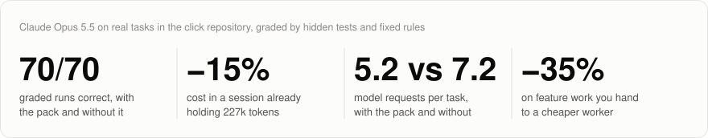
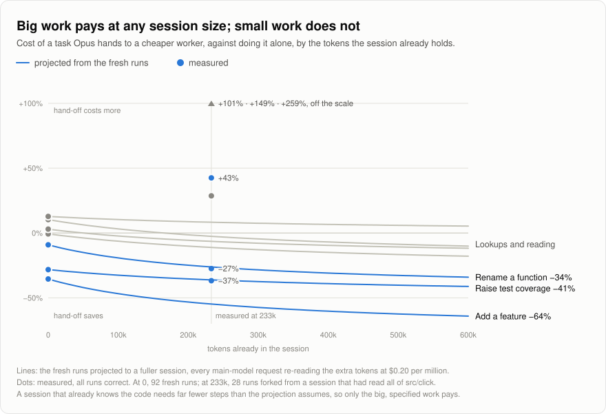

<div align="center">

<picture>
  <source media="(prefers-color-scheme: dark)" srcset="assets/banner-dark.svg">
  
</picture>

[](https://github.com/HarzerHeribert/claude-modpack/releases) [](LICENSE)  [](benchmarks/delegate-bench/SUITE.md) [](#the-mods)

Plugins built from Claude Code's function hooks that change how it works and what it shows.<br>
Each one stays quiet where it has no proof, and every claim below links to the runs behind it.

[Install](#install) · [The mods](#the-mods) · [Results](#results) · [How they fit together](#how-they-fit-together) · [In depth](#the-mods-in-depth) · [Benchmarks](benchmarks/)

</div>

<br>

<picture>
  <source media="(prefers-color-scheme: dark)" srcset="assets/hero-dark.svg">
  
</picture>

## Install

```
/plugin install modpack --marketplace HarzerHeribert/claude-modpack
```

That installs all six: the `modpack` plugin lists them as its dependencies. Answer `y` to add the marketplace, then pick a scope. One mod alone works the same way:

```
/plugin install smart-compact --marketplace HarzerHeribert/claude-modpack
```

Then, in the repository you work in:

```
/lsp-plus:setup
```

lsp-plus, delegate and cells build on Claude Code's LSP tool, which needs a language server for each language. The setup finds the repository's languages, checks which plugins and servers are missing, asks once, installs them, and confirms each after a restart. The same by hand: [Language servers](#language-servers).

Where a mod cannot do all it could on your machine, it says so when the session starts, with the command that fixes it: `/lsp-plus:setup` for a language without a server, `/cells:setup` where nothing can sandbox cells (Linux without bubblewrap on Node 22, Windows below Node 25). Claude is told as well, and offers the fix once.

## The mods

| | What it does | Measured |
| --- | --- | --- |
| **[statusline](#statusline)**<br><sub>interface</sub> | One line under the prompt: the model and its effort, how full the context is, the plan's 5-hour and 7-day use with their resets, and what other mods put on it. | Interface only. |
| **[smart-compact](#smart-compact)**<br><sub>cost</sub> | Keeps an idle session's prompt cache warm, or compacts it just before it expires, whichever is cheaper, and says on the line whether the next prompt is ready or cold. | Priced from the cache's list prices; not benchmarked. |
| **[delegate](#delegate)**<br><sub>cost</sub> | A `hand_off` tool: Claude gives a self-contained task to a Haiku or Sonnet worker and gets back the diff, a check the tool runs itself, and what it cost. | A feature or tests: **27–37% cheaper**, fresh and at 233k tokens. Smaller work costs more. Opus hands off only when told to. |
| **[lsp-plus](#lsp-plus)**<br><sub>code intelligence</sub> | A grep for a code symbol comes back with the language server's exact answer; references name the docs that use a symbol; edits that leave the docs behind say so; `/refs` finds stale names and dead links. | Rename: 3.2 requests instead of 5.0 without it. Even on the whole: it answers better, cells saves. |
| **[cells](#cells)**<br><sub>flow</sub> | A `run_cell` tool: several edits and their check in one step through the real Edit tool, the language server's references, definitions and renames, background runs. | **Earns the pack's savings**: without it the pack's −11% shrinks to −3%. |
| **[eta](#eta)**<br><sub>interface</sub> | Long-running and background jobs with a percentage and an estimated finish time above the prompt. | Interface only. |

## Results

Claude Opus 5.5 at xhigh effort on seven real tasks in the [click](https://github.com/pallets/click) repository, from a one-step lookup to a feature built from a spec, each graded by hidden tests or a fixed rule. **485 runs, every one correct.** Costs are list prices.

### The pack against plain Claude Code

With the pack, Opus needed **5.3 model requests per task instead of 7.1**. The work cost **8% less** in a fresh session and **14% less** in a session already holding 230k tokens. The savings come from fewer steps on multi-step work; on tasks of one to five requests the pack costs the same as plain Claude Code (−4% to +2%), because there it adds nothing to the conversation.

<picture>
  <source media="(prefers-color-scheme: dark)" srcset="assets/cost-dark.svg">
  
</picture>

<picture>
  <source media="(prefers-color-scheme: dark)" srcset="assets/requests-dark.svg">
  
</picture>

<details>
<summary><b>The numbers per task</b>: cost · model requests</summary>
<br>

| Task | Plain, fresh | Pack, fresh | Plain, 227k | Pack, 233k |
| --- | --- | --- | --- | --- |
| Add a feature | $0.85 · 16 | $0.80 · 10 | $0.98 · 12 | $0.82 · 7.5 |
| Raise test coverage | $0.84 · 10.5 | $0.66 · 7 | $0.78 · 8 | $0.73 · 6.5 |
| Rename a function | $0.38 · 6.5 | $0.35 · 5 | $0.40 · 6 | $0.26 · 3.5 |
| Explain a code path | $0.42 · 5 | $0.42 · 4.3 | $0.11 · 1 | $0.11 · 1 |
| Trace every caller | $0.34 · 5 | $0.33 · 4.2 | $0.14 · 2 | $0.14 · 2 |
| Find matching types | $0.31 · 3.7 | $0.31 · 3.5 | $0.09 · 1.5 | $0.06 · 1 |
| Look up a name | $0.26 · 3.2 | $0.27 · 2.8 | $0.06 · 1 | $0.06 · 1 |
| **Average task** | **$0.49 · 7.1** | **$0.45 · 5.3** | **$0.36 · 4.5** | **$0.31 · 3.2** |

Means of two runs each, six for the four small tasks fresh. Left out: three fresh pack runs that began with a cold cache and paid once, about $0.10, to cache the pack's tool definitions. The full write-up, with what each condition loaded, is [SUITE.md](benchmarks/delegate-bench/SUITE.md).
</details>

### Handing work to a cheaper worker

A hand-off pays on big, specified work, in a fresh session and in a full one: a feature from a spec and tests to a coverage target cost **27–37% less**. Everything smaller costs more handed off, most of all in a session that already knows the code, where Opus answers a lookup in one request and a hand-off takes two to five of its own.

<picture>
  <source media="(prefers-color-scheme: dark)" srcset="assets/delegate-dark.svg">
  
</picture>

<picture>
  <source media="(prefers-color-scheme: dark)" srcset="assets/growth-dark.svg">
  
</picture>

<details>
<summary><b>The numbers per task</b>: Opus alone → handed off</summary>
<br>

| Task | Fresh | In a 233k-token session |
| --- | --- | --- |
| Add a feature | $0.79 → $0.51 (−35%) | $0.82 → $0.52 (−37%) |
| Raise test coverage | $0.73 → $0.52 (−28%) | $0.73 → $0.53 (−27%) |
| Rename a function | $0.45 → $0.41 (−9%) | $0.26 → $0.38 (+43%) |
| Explain a code path | $0.42 → $0.42 (−1%) | $0.11 → $0.21 (+101%) |
| Trace every caller | $0.34 → $0.35 (+3%) | $0.14 → $0.18 (+29%) |
| Find matching types | $0.32 → $0.35 (+10%) | $0.06 → $0.23 (+259%) |
| Look up a name | $0.26 → $0.29 (+13%) | $0.06 → $0.15 (+149%) |

Means of two runs each, all correct. Fresh: the best hand-off that waits in the tool call ([RESULTS.md](benchmarks/delegate-bench/RESULTS.md)); 233k: Opus told in the prompt to hand off, or not ([SUITE.md](benchmarks/delegate-bench/SUITE.md)).
</details>

### What else the runs showed

- **cells earns the savings.** Taken out of the pack one at a time (156 runs, all correct, 95% intervals): the pack cost −11% [−17%, −5%] against plain Claude Code; without cells −3% [−9%, +2%]; without lsp-plus about the same as with it. Without cells the feature took 14.2 requests instead of 9.8, the rename 7.8 instead of 3.2. lsp-plus answers better (a rename in 3.2 requests instead of 5.0) without saving on the whole. [SUITE.md](benchmarks/delegate-bench/SUITE.md#which-mod-earns-it-the-ablation-z)
- **Opus never hands off by itself.** Offered the tool, given a routing rule, even told "Delegate where you see fit" by the person: 0 hand-offs in 70 runs. Told "do this through hand_off", every time. The hand-off is yours to ask for.
- **The language server, asked by the hook, saves steps.** With lsp-plus attaching the server's answer to a symbol grep, a rename took 3.4 requests instead of 4.6. A note *telling* Claude to ask the server was followed 0 times in 45, so it is off.
- **Unused connectors cost more than any mod saves.** With 378 deferred connector tools loaded and never used, fresh small tasks cost **34% more**: every session pays to cache their names and instructions. Turn off what Claude Code does not use.
- **The model is a lever too.** On work this size and this well specified, Sonnet 5.5 alone was as correct as Opus and 65% cheaper. These tasks cannot show where Sonnet falls short; delegate is for an Opus session on open-ended work that hands off its big, specified pieces.

## How they fit together

The mods never import each other. Each finds the others through Claude Code itself (a tool in the tool list, a note on a tool's result) and works alone when they are missing.

- **statusline is the line the others write on.** smart-compact adds its `● ready · cold in 44m` through `$.statusline.set(...)`, a segment whose countdown statusline counts; without statusline, smart-compact says the same in Claude Code's own status text.
- **lsp-plus answers a symbol grep from the language server** before Claude takes another step, and warms each language's server at session start, so cells' `refs()` and delegate's look at where a change reaches meet a warm server too.
- **lsp-plus enriches the language server's answers** (the docs that use a symbol) for whoever asks: delegate before a hand-off, cells' `refs()`, `defn()` and `rename()`.
- **Edits made in a cell go through the Edit tool**, so lsp-plus's check for docs that still use a removed name runs on them, and the notes other mods attach to a cell's calls come back in the cell's report.
- **smart-compact keeps long sessions' caches warm**, where delegate and cells pay most: both save model requests, and every request re-reads the whole context.
- **eta shows background shell jobs**, including those a cell starts; delegate shows its own workers in its card and pane.

### What makes the cut

A mod joins the pack when:
- it was measured ([`benchmarks/`](benchmarks/)) and cost no quality: every graded run stays correct;
- it saves cost or time, or makes the work more reliable (cells' edits keep a diff and `/rewind` where a script would not), or only adds interface;
- it works with the other mods and without them, and each of its behaviours can be switched off;
- it stays quiet where it has no proof: on a task it cannot help with it adds nothing to the conversation, and a note Claude does not act on is switched off.

## The mods in depth

### statusline

One line under the prompt, drawn in Claude Code's own hint row so the mode indicator and the status share it:

```
⏵⏵ auto mode on       Opus 5.5 xhigh   412k ━━━━━━──────   5h 34% ↺2h14   7d 12% ↺3d   ● ready · cold in 44m
```

- **Its own segments:** the model and its effort, the context against the auto-compact point (a highlight sweeps along it while Claude works), and how much of the plan's 5-hour and 7-day windows is used, with when each resets: quiet under half, plain past it, amber from 80%.
- **Other mods' segments:** a mod calls `$.statusline.set({ id, priority, parts, short?, side? })` and lists `statusline` among its dependencies. A part is text, a countdown (`{ until, prefix?, warnMs? }`, counted by the line) or a spinner (`{ spin: true }`), so a mod sends a segment when it changes, not every second. `$.statusline.remove({ id })` takes it off.
- **Narrow terminals** drop the least important first: the model, then the windows' resets, the windows, the gauge, and another mod's countdown before its own words.
- **Published pages:** a pill on the left lists the pages this session published with the Artifact tool.
- **Phone and IDE:** where no line is drawn, the same line is the session's status text, in a session the phone or IDE hosts. A terminal session watched over Remote Control (`/rc`) from the desktop app, the web or the phone gets no mod drawing and no status text as of Claude Code 2.1.296.

| Option | Default | |
| --- | --- | --- |
| `placement` | `line` | `tail`: appended dim to Claude Code's hint. `band`: above the prompt. `off`. |
| `limits` | `always` | `half`: a plan window only once it is half used. `off`: never. |
| `animate` | `true` | The highlight along the gauge. |

### smart-compact

An idle session's prompt cache expires after its TTL: 1 hour on a subscription, 5 minutes in overage or on an API key. The next prompt then writes the whole context to the cache again, at 1.25x (5 min) or 2x (1 h) the input price. For a 400k-token Opus 5.5 session on the 1-hour cache:

| Option | Cost |
| --- | --- |
| Let it expire, re-cache on return | $3.20 |
| One keep-alive (re-read the cached prefix; a read resets the TTL) | $0.09 |
| Compact before it expires | ~$0.87, plus detail lost to the summary |

A few minutes before the cache expires (2.5 min on the 1-hour TTL, 45 s on the 5-minute one), the `smart` strategy:

1. Sends keep-alives while they cost less than compacting would, counting lost detail as `compactPenaltyUsd`. It stops after `maxIdleHours`.
2. Then compacts while the cache is still warm.
3. Leaves small sessions alone: below `minSavingsUsd` of re-cache cost, or below `minCompactTokens` of context, it never compacts.

It never compacts while the prompt holds a draft or agents are running; it sends a keep-alive to hold the cache instead. If the machine sleeps past the deadline, it marks the cache expired and does nothing. A failed action is retried twice, 20 s apart. The TTL is detected from the plan and corrected from the cache hits and misses it observes.

On [statusline](#statusline)'s line it says whether the session is ready to prompt or has gone cold: `● ready`, `· cold in m:ss` (amber in the last five minutes), `· compacts in …` when an idle compaction is near, `○ cold`, or what it is doing (`compacting`, `keeping warm`, `paused`). `/cache` shows the live figures and plan; `/cache pause`, `/cache resume` and `/cache keepalive` control it.

| Option | Default | |
| --- | --- | --- |
| `strategy` | `smart` | `compact`: compact at the first expiry. `keepalive`: never compact. `off`: status line only. |
| `cacheTtl` | `auto` | `1h` or `5m` to override detection. |
| `minSavingsUsd` | `0.25` | Below this re-cache cost, the cache is left to expire. |
| `compactPenaltyUsd` | `0.5` | Higher keeps the cache warm longer before compacting. |
| `minCompactTokens` | `100000` | Never compacts a smaller context. |
| `maxIdleHours` | `6` | Stops keep-alives after this long idle. |
| `compactInstructions` | empty | Passed to idle compactions, like `/compact <text>`. |

Prices are list prices, so on a subscription they are API-equivalent estimates, not a bill.

### delegate

Every request of the main model re-reads its whole context: at 600k tokens on Opus 5.5 that is about $0.12 a step before any work is done. A worker reads only its own small context. Claude calls `hand_off` with a task that stands alone, `explore` (read only) or `edit`, the symbols or `file:line` places it touches (`focus`), for edits a `check` command, and the worker: `sonnet` for a feature, tests or other work across files, `haiku` for mechanical work.

1. **Where it reaches.** For each focus entry the mod asks the language server for references and callers (with lsp-plus, the docs that mention it come along) and tells the worker.
2. **The worker.** A subagent, read-only for `explore`, with Edit and Write for `edit`. The call waits for it inside the tool call (one request of the main model) and returns the report with the evidence; with `background` it returns at once and the report arrives as a message. A follow-up within 50 minutes goes to the same worker, its reading still in its context.
3. **The evidence.** The diff against a git snapshot taken at the start, however the worker edited; the check command, run by the mod itself; references outside the changed files; what the work cost against the same steps on the main model.
4. **The review.** The main model judges the diff and the check, not the report.
5. **The log.** Each hand-off goes to `~/.claude/mods/delegate/log.jsonl`; `/delegate` sums it up and opens a side pane. While a worker runs, its card turns with its clock, requests, cost and last actions.

Measured on 120 Opus runs, all correct: a feature or tests cost 27–37% less handed off; lookups, traces, explanations and small edits cost more. Opus does not hand off unless told to, so ask for it as an instruction: "hand the tests to a Sonnet worker".

| Option | Default | |
| --- | --- | --- |
| `model` | `haiku` | The worker's model when the call names none. |
| `wait` | `tool` | `tool`: the call waits for the report. `message`: it returns at once. Claude can pick either per call with `background`. |
| `review` | `inline` | `fork`: a forked review returns a verdict only. `auto`: fork for large evidence. |
| `reuseMinutes` | `50` | How long a worker stays warm for follow-ups. |
| `workerContextCap` | `60000` | A worker grown past this is not continued. |

### lsp-plus

- **The language server's answer to a symbol grep.** When grep, rg, git grep and the like look for a code symbol, lsp-plus asks the language server itself and attaches its answer to the grep's result: for a function the functions that call it, each named as it is nested (`Command.invoke (1412)`), otherwise its references, by file. Grep's own output stays for strings, comments and docs. A server still indexing gets up to 3 s, and without a whole answer there is none.
- **Servers warm from the start.** At session start each language the repository has gets one question, about its smallest tracked file, so its server has the project open before the first real one: about 1 s for Python, 4 s for TypeScript, saved later. The smallest file because Claude Code adds the problems a server reports about any file it has open to the conversation, and a near-empty file has none. A server costs memory (pyright about 440 MB, the TypeScript server up to 2 GB on a large repository) and runs until the session ends.
- **Docs in references.** `findReferences`, `goToDefinition` and `incomingCalls` also name the doc lines that use the symbol as code, which no language server indexes.
- **Docs that drift.** After an Edit or Write removes a name from the code that the docs still mention, Claude is told where, with the likely new name when it looks like a rename.
- **`/refs`** checks every doc in the repository for code names no file in the code has any more, and for links to files that do not exist.
- **A missing server said once.** Where the repository has five or more files of a language whose server does not answer, you see a line naming it, and Claude is told to offer `/lsp-plus:setup` once.
- **Markdown and SQL servers.** marksman for `.md`, postgres-language-server for `.sql`.

Measured: the grep answer cut a rename from 4.6 to 3.4 requests (−6.5% cost) and a trace from 4.3 to 3.9 (cost even), 7 runs each way, all correct; on tasks without a symbol grep it never spoke. Taken out of the pack, renames took 5.0 requests instead of 3.2 and the whole cost the same. Its warm-up once asked about click's `docs/conf.py`, whose diagnostics then reached every conversation (+4.5% on small tasks); it now asks about the smallest file of each kind, and costs nothing there. Options `answer`, `warm`, `docs` and `drift` turn those off; `nudge` turns on an older note that only told Claude which LSP call to make (never followed in 45 notes).

### cells

Built from 240 of the author's own Claude Code sessions (32,202 model requests). Models changed files with Python, sed or perl through Bash 5,996 times, against 2,720 Edit and Write calls: cheap, but the person sees no diff and `/rewind` cannot restore it. Requests that needed no judgment (a check run alone right after edits, one edit per request twice in a row, the same command again) cost about 2% of the spend.

- **`run_cell`** runs a short JavaScript program whose calls are real Read, Edit, Write, Bash and LSP calls, with the usual permissions; edits show as diffs and can be rewound:
  - several edits and their check in one step, instead of a script;
  - `refs(path, name)` and `defn(path, name)`, each place with its line, without loading the LSP tool;
  - `rename(path, name, newName)`, every reference the language server lists, edited through Edit, with where the old name still appears as text for Claude to judge.
- **Background.** `run_cell({ code, background: true })` returns at once and the report arrives as a message when the cell ends; ctrl+enter on a running cell moves it to the background the same way, Esc stops it after the call that is running. Inside a cell, `sh(command, { background: true })` starts Claude Code's own background task.
- **The chaining guidance**, a system-prompt section: what you already need in one call, known edits in one response with their check after them. In a [pilot](benchmarks/cells-pilot/) it cut Haiku's requests by 18% on small tasks.
- **Notes after the fact.** When a request did no more than a check right after edits, a second single edit in a row, or the same command again, the tool result gets one line: what the request re-read and how to save it. At most four per kind, spaced apart. Nothing is blocked.
- **Where it runs.** A cell acts only through Claude Code's tools, which your permissions and auto mode judge one call at a time; its runner is shut in so it has no other way out. On macOS that is Seatbelt, on Linux bubblewrap, and anywhere else Node 25 or later, whose permission model closes the network by itself (signals stay open there, and each cell's report says so on its first line). Where none of them is there, Linux on Node 22 without bubblewrap for one, cells does not run: you see a line saying why and what would fix it, Claude is told to offer the fix once, and `/cells:setup` does it with you. Tested on macOS and in Linux containers (bubblewrap on Node 22; Node 25 without it); Windows is untested.

| Option | Default | |
| --- | --- | --- |
| `mode` | `cells` | `nudge`: the guidance and the notes, no tool. `off`: nothing. |
| `nudges` | `true` | The notes. |
| `visuals` | `true` | Cells drawn as live cards. |

### eta

- **Background shell jobs** show above the prompt with how long they have run, as soon as Claude starts one.
- **`track_progress`** adds a percentage and an estimated finish time, read live from the job's output: a pattern counted against a total, a progress line, or the common bars (tqdm, pytest, cargo, `[3/10]`) without one. Before the progress is measurable, Claude's own guess stands in, marked as such.
- **What has run is done with.** A finished job shows its full gauge for a beat and leaves; a failure stays in red until you write again. Columns keep their widths while the numbers change.
- **Phone and IDE** get the same news as status text, and the tool's reply stays readable there. A terminal session watched over Remote Control (`/rc`) shows only that reply, as of Claude Code 2.1.296.

## Language servers

`/lsp-plus:setup` does this for the repository you are in. By hand: Claude Code's LSP tool, which lsp-plus, delegate and cells build on, needs the official LSP plugins (`claude plugin install <plugin>@claude-plugins-official --scope user`) and their servers on the `PATH`:

| Languages | Plugin (`@claude-plugins-official`) | Server |
| --- | --- | --- |
| TypeScript, JavaScript | `typescript-lsp` | `npm i -g typescript-language-server typescript@6` (TypeScript 7 has no `tsserver.js`, which the server needs) |
| Python | `pyright-lsp` | `npm i -g pyright` |
| Rust | `rust-analyzer-lsp` | `brew install rust-analyzer` |
| Swift | `swift-lsp` | Xcode |
| C, C++ | `clangd-lsp` | Xcode (`clangd`) |
| Java | `jdtls-lsp` | `brew install jdtls` |
| C# | `csharp-lsp` | `dotnet tool install -g csharp-ls` (0.18 on .NET 9) |
| PHP | `php-lsp` | `npm i -g intelephense` |
| Lua | `lua-lsp` | `brew install lua-language-server` |
| Markdown, SQL | lsp-plus | `brew install marksman postgres-language-server` |

## Developing

Each mod is a folder: `.claude-plugin/plugin.json`, `hooks/hooks.json` and a hooks module (`hooks/register.tsx`). Run Claude Code with one loaded from its folder, or list folders in `CLAUDE_CODE_PLUGIN_DIRS` (separated by `:`) so a saved edit reloads in a running session:

```sh
claude --plugin-dir ./cells
claude plugin validate cells   # manifest, hooks, everything the engine would refuse
claude plugin test cells       # its *.test.ts files, run against the engine
```

Claude Code writes the API types into `<mod>/.claude-plugin/types/` whenever it loads a mod; that folder is git-ignored, so `tsc -p <mod>` works once the mod has loaded. What decided each mod's shape is in [`benchmarks/`](benchmarks/), with the harness to run it again.

## License

MIT, see [LICENSE](LICENSE).
